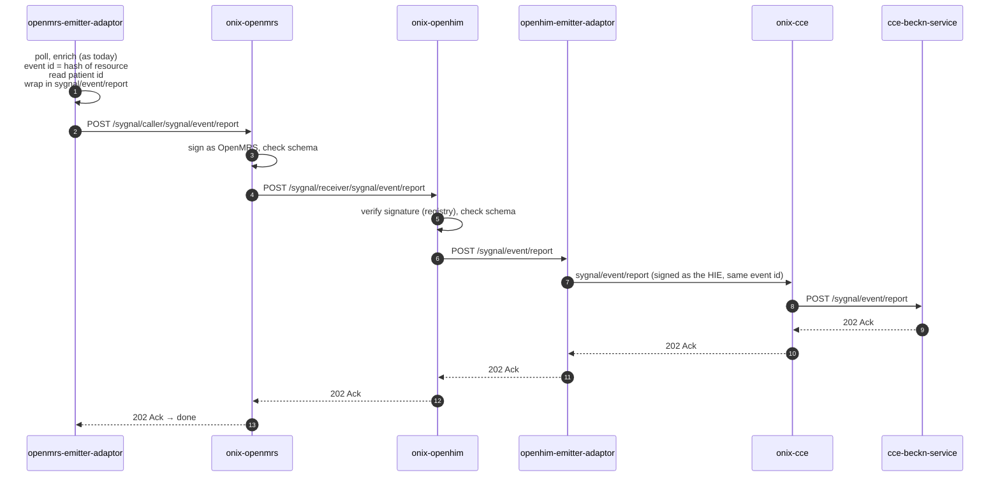
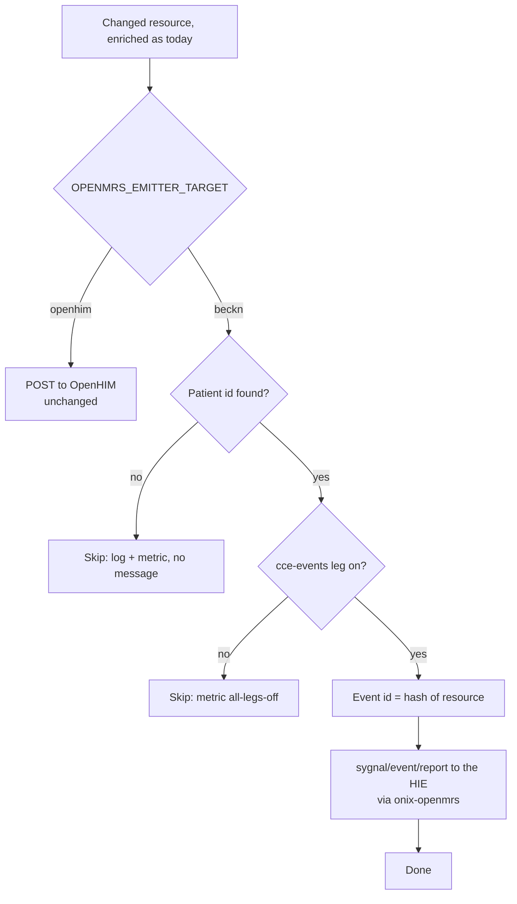

# Beckn Integration — OpenMRS CCE Emitter Adaptor

**Status:** Implemented on branch `sygnal-actions` (package `org.openphc.cce.emitter.beckn`), with unit tests and a stubbed-onix integration test. Not yet tested against real onix containers.

This document describes the emitter's part in the CCE Sygnal design. The emitter sends each clinical event to the HIE (OpenHIM) as the Sygnal action **`sygnal/event/report`**; the HIE passes it on to CCE. The wire format is the CCE profile of Sygnal, `schema/sygnal-profile/v1.0/cce-sygnal-apis.yaml` in the cce-beckn-service repository; that file is the binding contract for every participant.

The earlier Beckn design (`update` on an "HIE feed" contract, commitments, `bapId` / `bppId`, `on_update` / `on_status`) and the Spice referral legs (`on_status` for referral outcomes, `update` for referrals out) are **gone**. The OpenMRS side carries only the CCE leg.

With `OPENMRS_EMITTER_TARGET=openhim` nothing in this document applies. The emitter posts FHIR to OpenHIM exactly as it does today.

---

## 1. Summary

- A setting, `OPENMRS_EMITTER_TARGET`, chooses the path: `beckn` (the default on this branch) or `openhim` (today's path).
- In `beckn` mode the emitter posts one `sygnal/event/report` per changed resource to its own onix container (`onix-openmrs`), which signs it and delivers it to the HIE. The HIE passes the event on to CCE.
- The FHIR resource travels unchanged inside a `CceClinicalEvent` box (`eventAttributes`). The emitter builds no CloudEvent.
- Polling, enrichment (including the referral enrichers), the national-ID rewrite and the checkpoint stay as they are.
- No callbacks and no new endpoint. The synchronous answer (`202` + `Ack`, or a `Nack`) is the whole result.

---

## 2. The flow

```
OpenMRS emitter --sygnal/event/report--> HIE (OpenHIM emitter adaptor) --sygnal/event/report--> CCE (cce-beckn-service)
```

| Participant | Subscriber id (`senderId` / `receiverId`) | onix container |
|---|---|---|
| OpenMRS (this emitter) | `bap.openmrs.nextsteps.mdtlabs.org` | `onix-openmrs` |
| HIE | `bap.openhim.nextsteps.mdtlabs.org` | `onix-openhim` |
| CCE | `bpp.cce.nextsteps.mdtlabs.org` | `onix-cce` |

Each onix listens on `8082` inside its container. An app **sends** by posting the full message to `http://<onix-container>:8082/sygnal/caller/<action>`; onix signs it and delivers it to `context.receiverUri + "/" + action`. onix **receives** at `https://<public-host>/sygnal/receiver/<action>`, checks the signature and the schema, and forwards to the app at `/<action>`.



**The emitter in Beckn mode.**



---

## 3. The target switch

| `OPENMRS_EMITTER_TARGET` | Behaviour |
|---|---|
| `openhim` | Today's behaviour. `ForwardingEngine` posts FHIR JSON to `{OPENHIM_BASE_URL}/{ResourceType}` |
| `beckn` (default on this branch) | `BecknTargetForwarder` builds `sygnal/event/report` and posts it to the onix Sygnal caller |

The switch is read once at start. Changing it needs a restart. One emitter sends on one path only; it never sends the same resource to both.

What stays the same in both modes:

- `FhirPollerService` polling, paging and de-duplication.
- `OrderRevisionResolver`, `PatientReferenceRewriter`, `OrderIdentifierEnricher`, `ReferralResponseOrderEnricher` and the other enrichers and normalizers. Referral markers (`referral-response`, `inbound` / `outbound`, destination facility code) are still added to the resource; CCE reads them from the resource.
- `CheckpointStore` and the bookmark behaviour.
- The retry settings `emitter.openhim.retry.*`.

---

## 4. Processing steps in Beckn mode

`FhirPollerService.forwardOne` runs all enrichers as today and encodes the resource to JSON. It then hands the JSON to `BecknTargetForwarder` instead of `ForwardingEngine`. For each resource:

| Step | Class | What it does |
|---|---|---|
| 1 | `PatientIdReader` | Reads the patient id (§6). None: skip |
| 2 | `EventIdFactory` | Builds the event id from the resource JSON (§5) |
| 3 | `BecknMessageBuilder` | Builds `sygnal/event/report` (§8) |
| 4 | `OnixClient` | Posts it to `{caller-url}/sygnal/event/report`. Reads `Ack` / `Nack`. Retries when allowed (§10) |
| 5 | `BecknMessageLog` | Writes one log line for the message (§13) |
| 6 | `BecknTargetForwarder` | Returns a `ForwardResult` to the poller: a success only if the message got `Ack` |

After the page is done, the poller saves the checkpoint as it does today, whatever the results.

---

## 5. Event id

The event id is a name-based UUID of a SHA-256 hash of the resource JSON, with keys in a fixed order.

1. Take the resource JSON exactly as it goes into `resource`, after all enrichers.
2. Write it again with object keys sorted, at every level. Arrays keep their order. No whitespace.
3. Hash the UTF-8 bytes with SHA-256.
4. Build a version-5 (name-based) UUID from the hex hash (lower-case hex, as UTF-8 text), with a fixed namespace UUID set once in the code: `6f1c9a52-3d8e-4b27-9e14-0a7c5d2b8f31` (`EventIdFactory.NAMESPACE`).

Decimals are read exactly (`1.50` stays `1.50`), both for the hash and for the `resource` that is sent.

The event id is `message.events[0].id`, the `CoordinationEvent` id (the schema requires a UUID). The HIE forwards the event to CCE with the **same id** on every hop, so CCE's collector recognises a repeat and answers `Ack` without storing it twice. CCE allows at most 50 characters; a UUID is 36.

Why a hash and not `meta.lastUpdated`:

- The same change always gets the same id. A resend gives the same id, and CCE drops the duplicate.
- Any change to the resource gives a new id. After CCE refuses an event (`BIZ_GENERIC_ERROR`), the corrected resource has a new hash, so it gets a new id. With the old id CCE would drop it as a duplicate.
- The resource type and id are inside the JSON, so two resources never share an id.
- OpenMRS can change an older order's status without moving its `lastUpdated`. The timestamp also has whole seconds only, and can be missing.

The namespace UUID must never change. If it does, every event gets a new id.

`sourceEventId` in the box is `{ResourceType}/{id}`. It is not the event id.

---

## 6. Patient id

`patientId` is required by the `CceClinicalEvent` box. `PatientIdReader` reads it in a simple way:

| Resource | `patientId` |
|---|---|
| `Patient` | Its national-id identifier (system `emitter.patient.national-id.system`); if it has none, its id. `PatientReferenceRewriter` has already set the id to the national ID, so both are normally the same |
| Any resource with `subject` or `patient` | The reference without `Patient/`. `PatientReferenceRewriter` has already put the national ID there |

No facility id is read. The HIE reads the facility from the resource, as today.

The emitter makes no extra call to OpenMRS for this. It relies on the national-ID rewrite (`emitter.patient.national-id.*`). With `on-missing=forward-as-is`, the reference can still hold the OpenMRS UUID; that value is then sent as is.

**Resources without a patient** (for example `Location`, `Practitioner`, or a reference that is not `Patient/…`): the emitter **skips** them. It sends no message, writes one INFO line `beckn skip resourceType=… reason=no-patient`, and counts `openmrs_beckn_resources_skipped_total{reason="no-patient"}`. The bookmark moves on as for any other resource. To stop polling them at all, remove them from `POLLING_FHIR_RESOURCE_TYPES`.

---

## 7. Referrals

The emitter no longer sends anything to Spice. A referral `ServiceRequest` (in or out, open or finished) is one more clinical event: it goes to the HIE as `sygnal/event/report` like every other resource. The referral enrichers still add their markers (`referral-response` category and `basedOn`, `inbound` / `outbound` direction, destination facility code on `performer`), so CCE can match referrals with its PlanDefinitions as before.

---

## 8. The message

`BecknMessageBuilder` fills the message from the settings. There is no contract, no commitment, no `bapId` / `bppId` / `bapUri` / `bppUri`: the Sygnal `context` is a closed object and onix refuses any other field.

**`context`**

| Field | Value |
|---|---|
| `version` | `2.0.0` |
| `action` | `sygnal/event/report` |
| `networkId` | `self.network-id` (required) |
| `senderId` | `self.id` (`bap.openmrs.nextsteps.mdtlabs.org`) |
| `receiverId` | `hie.id` (`bap.openhim.nextsteps.mdtlabs.org`) |
| `receiverUri` | `hie.uri`: the HIE's public onix receiver base, e.g. `https://hie.example.org/sygnal/receiver` (onix appends the action) |
| `transactionId` | `hie.transaction-id` when set (must be a UUID); otherwise a new random UUID per event, kept across the retries of that event. Never derived from patient data |
| `messageId` | A new random UUID for every attempt, including each retry (§10) |
| `timestamp` | The send time of the attempt |

**`message.events[0]`** — exactly one `sygnal:CoordinationEvent`, with **no `@context`** (onix would refuse it):

| Field | Value |
|---|---|
| `@type` | `sygnal:CoordinationEvent` |
| `id` | The event id (§5) |
| `revision` | `1`, always. A correction is a new event with a new id |
| `eventType` | `DELIVERY_RECORDED`. The CCE kind of event is `eventAttributes.eventType` |
| `granularity` | `INDIVIDUAL` |
| `from` | `{ "id": self.id, "role": "PROVIDER" }`. `from.id` equals `context.senderId` |
| `occurredAt` | `meta.lastUpdated` of the resource as a UTC instant; the build time if it is missing or not a full timestamp (see below) |
| `eventAttributes` | The `CceClinicalEvent` box (below), unchanged from the former `performanceAttributes` |

`occurredAt` is when OpenMRS recorded **this version** of the resource, which is the version the event id is the hash of. It is present on every resource type and is always a full instant. The time of the clinical act itself (`Encounter.period.start`, `Observation.effectiveDateTime`, `ServiceRequest.authoredOn`, …) stays in the resource; CCE's `ClinicalEventTimeExtractor` reads it from there and prefers it over the envelope time for its schedules, so the emitter does not keep a second copy of that table. Note that a prior order refetched by `OrderRevisionResolver` keeps its old `lastUpdated` (OpenMRS does not move it when the status flips), so its `occurredAt` is the time of the original order.

**`eventAttributes`** uses the `CceClinicalEvent` schema:

| Field | Required | Value |
|---|---|---|
| `@context` | Yes | `{OPENMRS_EMITTER_BECKN_SCHEMA_BASE_URL}/CceClinicalEvent/v1.0/context.jsonld` |
| `@type` | Yes | `cce:CceClinicalEvent` |
| `eventType` | Yes | The FHIR resource type |
| `patientId` | Yes | §6 |
| `fhirVersion` | Yes | `4.0.1` |
| `resource` | Yes | The FHIR resource, as the emitter built it |
| `sourceEventId` | No | `{ResourceType}/{id}` |

There is no CloudEvent in the emitter. CloudEvents exist only in the HIE and in CCE.

---

## 9. Message sample

Posted to `{OPENMRS_EMITTER_BECKN_ONIX_CALLER_URL}/sygnal/event/report`, by default `http://onix-openmrs:8082/sygnal/caller/sygnal/event/report`. The action is appended with its slashes as they are, never URL-encoded (`%2F`).

```json
{
  "context": {
    "version": "2.0.0",
    "action": "sygnal/event/report",
    "networkId": "sygnal.nextsteps.mdtlabs.org/sygnal_demo_network_registry",
    "senderId": "bap.openmrs.nextsteps.mdtlabs.org",
    "receiverId": "bap.openhim.nextsteps.mdtlabs.org",
    "receiverUri": "https://hie.example.org/sygnal/receiver",
    "transactionId": "0d5f8c1a-7b2e-4f6d-9a3c-1e2b3c4d5e6f",
    "messageId": "9c4e2a10-5d6f-4b7a-8c9d-0e1f2a3b4c5d",
    "timestamp": "2026-11-13T08:00:35Z"
  },
  "message": {
    "events": [
      {
        "@type": "sygnal:CoordinationEvent",
        "id": "3f6c1c1e-8a53-5b0e-9d7a-2b6f4e1a9c10",
        "revision": 1,
        "eventType": "DELIVERY_RECORDED",
        "granularity": "INDIVIDUAL",
        "from": { "id": "bap.openmrs.nextsteps.mdtlabs.org", "role": "PROVIDER" },
        "occurredAt": "2026-11-13T08:00:12Z",
        "eventAttributes": {
          "@context": "https://raw.githubusercontent.com/openphc/cce-beckn-service/main/schema/CceClinicalEvent/v1.0/context.jsonld",
          "@type": "cce:CceClinicalEvent",
          "eventType": "Encounter",
          "patientId": "1198503150001234",
          "fhirVersion": "4.0.1",
          "sourceEventId": "Encounter/7d2c9b1e-4f3a-4e8b-9c6d-5a1b2c3d4e5f",
          "resource": {
            "resourceType": "Encounter",
            "id": "7d2c9b1e-4f3a-4e8b-9c6d-5a1b2c3d4e5f",
            "meta": { "lastUpdated": "2026-11-13T08:00:12.000+00:00" },
            "status": "finished",
            "subject": { "reference": "Patient/1198503150001234" },
            "period": { "start": "2026-11-13T07:30:00Z", "end": "2026-11-13T08:00:00Z" },
            "location": [ { "location": { "reference": "Location/0002" } } ]
          }
        }
      }
    ]
  }
}
```

This is the sample the tests check against (`src/test/resources/beckn/sample-event-report.json`).

---

## 10. Answers and retries

onix passes the far side's answer back in the same HTTP call. The answer comes back hop by hop from CCE, so an `Ack` means CCE accepted the event (or already had it).

### 10.1 The answer body

`Ack`, HTTP 202:

```json
{ "message": { "status": "ACK", "messageId": "9c4e2a10-5d6f-4b7a-8c9d-0e1f2a3b4c5d" } }
```

`Nack`, HTTP 400 (the sender's error) or 5xx (temporary):

```json
{
  "message": {
    "status": "NACK",
    "messageId": "9c4e2a10-5d6f-4b7a-8c9d-0e1f2a3b4c5d",
    "error": { "code": "SCH_REQUIRED_FIELD_MISSING", "message": "events[0].id is missing" }
  }
}
```

Codes the emitter may see (canonical Beckn codes):

| Code | HTTP | Meaning |
|---|---|---|
| `CTX_MISSING_FIELD`, `CTX_INVALID_FIELD`, `CTX_ACTION_MISMATCH` | 400 | Something wrong in `context` (for example `receiverId` is not the receiver's id) |
| `SCH_INVALID_JSON`, `SCH_REQUIRED_FIELD_MISSING`, `SCH_SCHEMA_VALIDATION_FAILED`, `SCH_TYPE_NOT_SUPPORTED` | 400 | The message does not match the schema |
| `BIZ_GENERIC_ERROR` | 400 | CCE's collector refused the event |
| `NET_DOWNSTREAM_UNAVAILABLE`, `NET_INTERNAL_ERROR` | 500 | Something on the route is down. Send again later |

The emitter decides by HTTP status and `status`, not by code, so an unknown code is handled the same way.

As built (`OnixAnswer`): any 2xx answer (202 included) counts as `Ack` unless its body says `NACK`; a 2xx with a `NACK` body is a `Nack`. A body that is empty or not JSON is judged by its HTTP status alone.

### 10.2 What the emitter does

| Answer | Meaning | The emitter |
|---|---|---|
| 2xx (normally 202) and not `NACK` | Accepted, or already known | Done |
| HTTP 400 (`NACK`), or any other 4xx except 408 and 429 | The message is wrong: schema, signature, context, or refused | Fails the message. **No retry.** Logs `error.code` and `error.message` |
| HTTP 500 or other 5xx, 408, 429, timeout, or no answer | Something on the route is down or slow | Sends again |

- A resend keeps the same event id (`events[0].id`) and `transactionId`, and uses a **new** `messageId`. CCE knows the event by its id, not by `messageId`.
- Retries use the existing settings `emitter.openhim.retry.max-attempts` (default 3) and `emitter.openhim.retry.backoff-ms` (default 2000, linear: backoff × attempt), as in `ForwardingEngine`.
- After the last try the emitter drops the message. It moves its bookmark on, as it does today.
- Sending again is safe. CCE answers `Ack` to a repeat and drops it.

### 10.3 Callbacks

There are none. No `on_report`, `on_update` or `on_status` follows. The synchronous answer is the whole result.

### 10.4 Timeout budget

The answer comes back through every hop. Each hop must wait longer than the hop behind it, and the onix default wait (`responseHeaderTimeout`, 5 s) must be raised on every onix container in the chain. The emitter's wait (`emitter.beckn.onix.timeout`, 50 s) is the outermost. The numbers are a starting point to agree with the HIE and CCE teams. Resources are sent one after another, so when the far side is slow, the poll is slowed too.

---

## 11. Settings

```yaml
emitter:
  target: ${OPENMRS_EMITTER_TARGET:beckn}           # beckn (default on this branch) | openhim
  beckn:
    onix:
      caller-url: ${OPENMRS_EMITTER_BECKN_ONIX_CALLER_URL:http://onix-openmrs:8082/sygnal/caller}
      timeout: ${OPENMRS_EMITTER_BECKN_ONIX_TIMEOUT:50s}
    schema-base-url: ${OPENMRS_EMITTER_BECKN_SCHEMA_BASE_URL:https://raw.githubusercontent.com/openphc/cce-beckn-service/main/schema}
    self:
      id: ${OPENMRS_EMITTER_BECKN_SELF_ID:bap.openmrs.nextsteps.mdtlabs.org}
      network-id: ${OPENMRS_EMITTER_BECKN_SELF_NETWORK_ID:}            # required
    hie:
      id: ${OPENMRS_EMITTER_BECKN_HIE_ID:bap.openhim.nextsteps.mdtlabs.org}
      uri: ${OPENMRS_EMITTER_BECKN_HIE_URI:}                           # required
      transaction-id: ${OPENMRS_EMITTER_BECKN_HIE_TRANSACTION_ID:}     # optional UUID
    legs:
      cce-events: ${OPENMRS_EMITTER_BECKN_LEG_CCE_EVENTS:true}
```

| Setting | Meaning |
|---|---|
| `onix.caller-url` | Sygnal caller of `onix-openmrs`. The emitter appends `/sygnal/event/report` |
| `onix.timeout` | Time to wait for one answer. Default 50 s. Must be longer than the timeouts of all hops behind it (§10.4) |
| `schema-base-url` | Base of the `CceClinicalEvent` `@context` URL. The schema files are in the `schema/` folder of the cce-beckn-service repository |
| `self.id` | OpenMRS's subscriber id: `context.senderId` and `from.id`. Must be the subscriber id of the keys in `onix-openmrs` |
| `self.network-id` | Required. `context.networkId` |
| `hie.id` | The HIE's subscriber id: `context.receiverId`. The HIE refuses a report not addressed to it |
| `hie.uri` | The HIE's public onix receiver base: `context.receiverUri`. onix delivers to `{hie.uri}/sygnal/event/report` |
| `hie.transaction-id` | Optional. A fixed UUID for `context.transactionId`. Empty: a new UUID per event |
| `legs.cce-events` | With `false` nothing is sent; every resource is skipped (`reason="all-legs-off"`) |

| Variable | Default | Description |
|---|---|---|
| `OPENMRS_EMITTER_TARGET` | `beckn` (this branch) | `openhim` or `beckn` |
| `OPENMRS_EMITTER_BECKN_ONIX_CALLER_URL` | `http://onix-openmrs:8082/sygnal/caller` | onix Sygnal caller base URL |
| `OPENMRS_EMITTER_BECKN_ONIX_TIMEOUT` | `50s` | Wait for one answer |
| `OPENMRS_EMITTER_BECKN_SCHEMA_BASE_URL` | `https://raw.githubusercontent.com/openphc/cce-beckn-service/main/schema` | Schema base URL |
| `OPENMRS_EMITTER_BECKN_SELF_ID` | `bap.openmrs.nextsteps.mdtlabs.org` | Own subscriber id |
| `OPENMRS_EMITTER_BECKN_SELF_NETWORK_ID` | — (required) | `context.networkId` |
| `OPENMRS_EMITTER_BECKN_HIE_ID` | `bap.openhim.nextsteps.mdtlabs.org` | The HIE's subscriber id |
| `OPENMRS_EMITTER_BECKN_HIE_URI` | — (required) | The HIE's public onix receiver base |
| `OPENMRS_EMITTER_BECKN_HIE_TRANSACTION_ID` | — | Optional fixed transaction UUID |
| `OPENMRS_EMITTER_BECKN_LEG_CCE_EVENTS` | `true` | Send to the HIE |

Raise `OPENHIM_RETRY_MAX_ATTEMPTS` and `OPENHIM_RETRY_BACKOFF_MS` above 3 and 2000 ms in Beckn mode (§14).

The `emitter.openhim.*` connection and auth settings are not used in Beckn mode. The onix caller needs no auth header; it is reachable only inside the OpenMRS network.

As built:

- `self.id` and `hie.id` default to the ids of the CCE Sygnal network. `self.network-id` and `hie.uri` have **no defaults**. `application-beckn-demo.yml` (profile `beckn-demo`) holds example values (the HIE host there is made up).
- With `OPENMRS_EMITTER_TARGET=beckn` the emitter checks the settings at start and **fails to start** with a message naming every missing or wrong setting: `hie.uri` must be an absolute `http(s)` URL and `hie.transaction-id`, when set, a UUID. The HIE settings are required only when `legs.cce-events` is on.
- `emitter.target` accepts `openhim` or `beckn` (any case); any other value stops the start.
- Removed settings: `onix.bap-caller-url`, `onix.bpp-caller-url`, `self.bap-*`, `self.bpp-*`, `openhim.*` (`bpp-id`, `bpp-uri`, `contract-id`, `transaction-id`, `commitment-file`), `spice.*`, `legs.referrals-in`, `legs.referrals-out`, and their `OPENMRS_EMITTER_BECKN_*` variables. Spring ignores them if they are still set.

---

## 12. Classes

Package `org.openphc.cce.emitter.beckn`; its beans exist only when `OPENMRS_EMITTER_TARGET=beckn`. Settings are in `EmitterProperties` as `target` and a nested `beckn` config.

| Class | Responsibility |
|---|---|
| `BecknTargetForwarder` | Entry point in Beckn mode. Called by `FhirPollerService` in place of `ForwardingEngine`. Runs the steps in §4 and returns a `ForwardResult` |
| `EventIdFactory` | Sorted-key JSON → SHA-256 → name-based UUID (§5) |
| `PatientIdReader` | Reads `patientId` from `subject` / `patient`, or a `Patient`'s national-id identifier / id (§6) |
| `BecknMessageBuilder` | Builds `sygnal/event/report`: `context`, the `CoordinationEvent` and the `CceClinicalEvent` box (§8) |
| `OnixClient` | Posts to the onix Sygnal caller. Reads `Ack` / `Nack`. Applies the retry rules in §10. Records metrics |
| `BecknMessageLog` | Writes one log line per message (§13) |
| `OnixAnswer` | Reads one answer: `Ack`, `Nack` (no retry) or retry (§10) |
| `OutgoingMessage` | One message ready to post; gives a copy with a new `messageId` and `timestamp` for each attempt |
| `BecknConfiguration`, `BecknSettingsValidator` | Beckn-mode beans (the onix HTTP client with `onix.timeout`) and the start-up check of the settings (§11) |
| `health/OnixHealthIndicator` | Health check `onix` in Beckn mode (§13.3) |

```
FhirPollerService.forwardOne
  └── enrichers (unchanged)
        └── OPENMRS_EMITTER_TARGET=openhim → ForwardingEngine           (today)
            OPENMRS_EMITTER_TARGET=beckn   → BecknTargetForwarder
                                       ├── PatientIdReader
                                       ├── EventIdFactory
                                       ├── BecknMessageBuilder
                                       ├── OnixClient ──► onix-openmrs /sygnal/caller/sygnal/event/report
                                       └── BecknMessageLog
```

---

## 13. Metrics and logging

### 13.1 Metrics

Prometheus names. Tags: `leg` (`cce-events`), `action` (`sygnal/event/report`), and `outcome` where shown.

| Metric | Type | Tags | Description |
|---|---|---|---|
| `openmrs_beckn_messages_sent_total` | Counter | `leg`, `action`, `outcome` (`ack`, `nack`, `error`) | Messages finished, by final result |
| `openmrs_beckn_send_retries_total` | Counter | `leg`, `action` | Resends after a 5xx or timeout |
| `openmrs_beckn_messages_dropped_total` | Counter | `leg`, `action`, `reason` (`nack`, `retries-exhausted`) | Messages given up on |
| `openmrs_beckn_onix_latency_seconds` | Timer | `leg`, `action` | Time for one onix call (each attempt) |
| `openmrs_beckn_resources_skipped_total` | Counter | `resourceType`, `reason` (`no-patient`, `all-legs-off`, `invalid-json`) | Resources not sent (§6) |

`openmrs_beckn_referrals_out_total` is gone with the Spice legs. The existing `openmrs_emitter_poll_*` and `openmrs_emitter_checkpoint_*` metrics keep working. `openmrs_emitter_forward_*` counts only the OpenHIM path.

### 13.2 Logging

`BecknMessageLog` writes one INFO line per message when it ends, and one WARN line per retry:

```
beckn action=sygnal/event/report leg=cce-events messageId=9c4e… transactionId=0d5f… eventId=3f6c… resourceType=Encounter attempt=1 result=ACK httpStatus=202 latencyMs=412
```

- No message bodies. No patient data: no `patientId`, no names.
- For a `Patient` resource the resource id is the national ID, so the line carries the event id only, not the resource id.
- On `Nack` the line carries `error.code` and `error.message` from the answer.
- Each attempt has its own `messageId`. The event id stays the same, so search by event id to follow all attempts and all hops.
- Values of `result`: `ACK`, `NACK`, `NO_ANSWER`, or `HTTP_<code>` when the body has no status. A retry line ends with `next=retry`; a final line is WARN when the message failed.

### 13.3 Health

In Beckn mode the `openhim` health check is not registered, so `/actuator/health` does not depend on OpenHIM. The `onix` check sends a `GET` to `{caller-url}/sygnal/event/report` (when `legs.cce-events` is on). Any HTTP answer counts as reachable (the caller takes only `POST`); no answer within 5 s makes it `DOWN`. With `openhim` the checks are as before.

---

## 14. Limits and open questions

| Topic | What it means for the emitter |
|---|---|
| Lost messages | After the last try the message is dropped and the bookmark moves on, as today. CCE advises resending with a growing wait (1 min, 5 min, 30 min); the emitter's retries are seconds apart. Proposal: more tries first; later, do not move the bookmark past a failed resource |
| JSON must be stable | The event id is a hash. If an enricher adds a field that changes between polls (a time, a random id), every resend looks like a new event to CCE |
| `occurredAt` | `meta.lastUpdated`, not the clinical time (§8). A refetched prior order carries its old `lastUpdated` |
| Slow answers slow the poll | Resources are sent one after another, and the answer comes back through every hop. `onix.timeout` (50 s) must be longer than every inner hop's timeout (§10.4), or the emitter resends an event that got through (safe: CCE drops the repeat) |
| Adapter behaviour untested | The answer handling relies on onix passing the far side's `Ack` / `Nack` back in the same call |
| `eventType` values | `eventAttributes.eventType` is the FHIR resource type |
| Spice | No longer reached from OpenMRS. Referral outcomes and referrals out reach CCE only, through the HIE |
