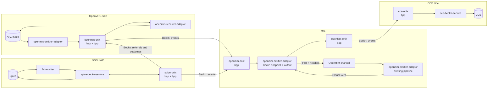
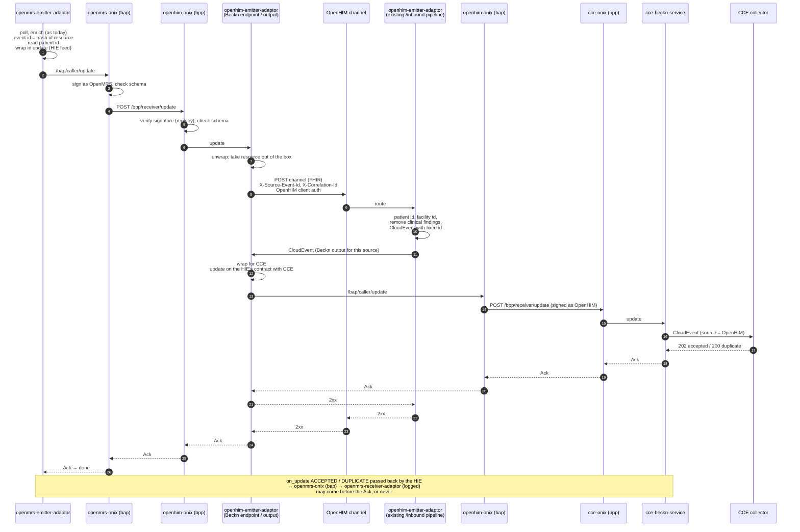
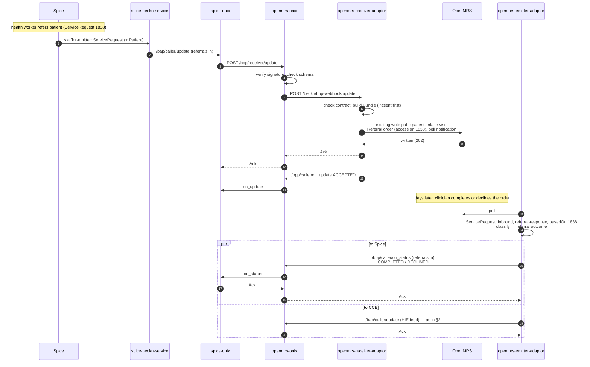
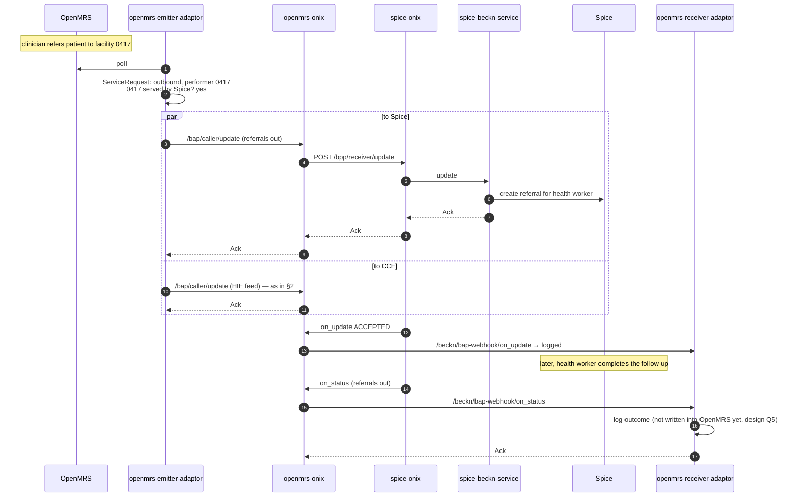
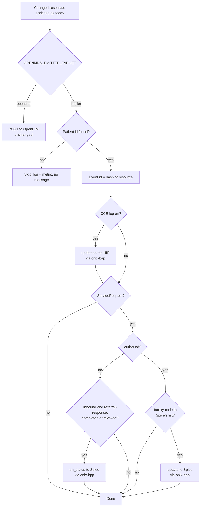

# Beckn Integration — OpenMRS CCE Emitter Adaptor

**Status:** Implemented on branch `demo-beckn` (package `org.openphc.cce.emitter.beckn`), with unit tests and a stubbed-onix integration test. Not yet tested against real onix containers. Where the build settled a point the proposal left open, the text below says so (§6, §10.1, §11, §13, §14).

This document describes the emitter's part in the Beckn design. The full design, for all OpenMRS components, is the central document **"Design: Beckn support for OpenMRS"** in the `openmrs-beckn-service` repository. Section numbers in brackets, such as (§4.5), point to that document.

With `OPENMRS_EMITTER_TARGET=openhim` (the default) nothing in this document applies. The emitter posts FHIR to OpenHIM exactly as it does today.

---

## 1. Summary

- A new setting, `OPENMRS_EMITTER_TARGET`, chooses the path: `beckn` (the default on the `demo-beckn` branch) or `openhim` (today's path).
- In `beckn` mode the emitter posts Beckn messages to the `openmrs-onix` adapter containers instead of FHIR to OpenHIM.
- Every changed resource goes to the HIE as one `update`. The HIE passes it on to CCE.
- A referral `ServiceRequest` can also lead to one message to Spice: `on_status` for the outcome of a referral from Spice, or `update` for a referral out to Spice.
- The FHIR resource travels unchanged inside a `CceClinicalEvent` box. The emitter builds no CloudEvent.
- Polling, enrichment, the national-ID rewrite and the checkpoint stay as they are.
- No new endpoint. Callbacks (`on_update`, Spice's `on_status`) go to the receiver adaptor, not the emitter.

---

## 2. The four flows

This is the confirmed end-to-end picture, copied from the central design.

```
---- OpenMRS to CCE ----
openmrs-emitter-adaptor → openmrs-onix(bap) ══► openhim-onix(bpp) → openhim-emitter-adaptor (unwrap) → OpenHIM channel → openhim-emitter-adaptor
                                                                                                                         │
                                         cce-onix(bpp) ◄══ openhim-onix(bap) ◄── openhim-emitter-adaptor (wrap) ◄───────────┘
                                              │
                                              └──► cce-beckn-service → CCE

---- Spice to CCE ----
fhir-emitter → spice-beckn-service → spice-onix(bap) ══► openhim-onix(bpp) → … the same as above … → CCE

---- Spice to OpenMRS ----
Spice → fhir-emitter → spice-beckn-service → spice-onix(bap) ══► openmrs-onix(bpp) → openmrs-receiver-adaptor → OpenMRS

---- OpenMRS to Spice ----
OpenMRS → openmrs-emitter-adaptor → openmrs-onix(bap) ══► spice-onix(bpp) → spice-beckn-service → Spice
```

══ marks a Beckn hop: signed by the sender's adapter and checked by the receiver's adapter. ─ marks plain HTTP.

### 2.1 The emitter's part in each flow

| Flow | Emitter's part |
|---|---|
| OpenMRS to CCE | Sends every changed resource as `update` on the "HIE feed" contract, through `onix-bap`. In the HIE, `openhim-cce-emitter-adaptor` unwraps it, runs it through the OpenHIM channel and its existing pipeline (patient, facility, redaction, CloudEvent), then wraps it and sends it to CCE over Beckn |
| Spice to CCE | None |
| Spice to OpenMRS | The receiver adaptor writes the referral. When the clinician completes or declines it, the emitter sends `on_status` to Spice on the "referrals in" contract, through `onix-bpp` (§5.4, steps 5–6) |
| OpenMRS to Spice | Sends `update` to Spice on the "referrals out" contract, through `onix-bap`, when the destination facility is one Spice serves (§5.5) |

In the last two flows the emitter also sends the same `ServiceRequest` to the HIE for CCE, as in the first flow (§5.6).

### 2.2 Flow diagrams

The diagrams below are the same as in the central design's flow diagrams. Mermaid notation. CCE alerts to OpenMRS are out of scope for now and are not drawn.

**All four flows**



**OpenMRS → CCE: an event.** The emitter sends `update` on the HIE feed contract. Everything after `openhim-onix` happens in the HIE.



**Spice → OpenMRS: a referral, and its outcome.** The receiver takes the referral. Later the emitter sends the outcome as `on_status`, and the same order to the HIE.



**OpenMRS → Spice: a referral, and its outcome.** The emitter sends `update` on the "referrals out" contract. Spice's callbacks go to the receiver.



**The emitter in Beckn mode.** Each message is sent and retried on its own.




---

## 3. The target switch

| `OPENMRS_EMITTER_TARGET` | Behaviour |
|---|---|
| `openhim` | Today's behaviour. `ForwardingEngine` posts FHIR JSON to `{OPENHIM_BASE_URL}/{ResourceType}` |
| `beckn` (default on `demo-beckn`) | `BecknTargetForwarder` builds Beckn messages and posts them to the `openmrs-onix` callers |

The switch is read once at start. Changing it needs a restart. One emitter sends on one path only; it never sends the same resource to both.

What stays the same in both modes:

- `FhirPollerService` polling, paging and de-duplication.
- `OrderRevisionResolver`, `PatientReferenceRewriter`, `OrderIdentifierEnricher`, `ReferralResponseOrderEnricher` and the other enrichers and normalizers.
- `CheckpointStore` and the bookmark behaviour.
- The retry settings `emitter.openhim.retry.*`.

---

## 4. Processing steps in Beckn mode

`FhirPollerService.forwardOne` runs all enrichers as today and encodes the resource to JSON. It then hands the JSON to `BecknTargetForwarder` instead of `ForwardingEngine`. For each resource:

| Step | Class | What it does |
|---|---|---|
| 1 | `EventIdFactory` | Builds the event id from the resource JSON (§5) |
| 2 | `PatientIdReader` | Reads the patient id (§6) |
| 3 | `BecknMessageBuilder` | Builds `update` on the HIE feed contract |
| 4 | `OnixClient` | Posts it to `onix-bap`'s caller. Reads `Ack` / `Nack`. Retries when allowed (§10) |
| 5 | `ReferralClassifier` | For a `ServiceRequest`, decides whether Spice gets a message too (§7) |
| 6 | `BecknMessageBuilder` + `OnixClient` | If so, builds and posts `on_status` (through `onix-bpp`) or `update` (through `onix-bap`) |
| 7 | `BecknMessageLog` | Writes one log line per message (§13) |
| 8 | `BecknTargetForwarder` | Returns a `ForwardResult` to the poller. It is a success only if every message for the resource got `Ack` |

Step 6 runs whether step 4 worked or not. The two messages are sent and retried on their own (§5.6).

After the page is done, the poller saves the checkpoint as it does today, whatever the results.

---

## 5. Event id

The event id is a name-based UUID of a SHA-256 hash of the resource JSON, with keys in a fixed order (§5.2).

1. Take the resource JSON exactly as it goes into `resource`, after all enrichers.
2. Write it again with object keys sorted, at every level. Arrays keep their order. No whitespace.
3. Hash the UTF-8 bytes with SHA-256.
4. Build a version-5 (name-based) UUID from the hex hash (lower-case hex, as UTF-8 text), with a fixed namespace UUID set once in the code: `6f1c9a52-3d8e-4b27-9e14-0a7c5d2b8f31` (`EventIdFactory.NAMESPACE`).

Decimals are read exactly (`1.50` stays `1.50`), both for the hash and for the `resource` that is sent.

The event id is used as `performance[0].id`. Every message carries exactly one performance entry. The HIE's mediator copies the id into `X-Source-Event-Id`. It then derives its own CloudEvent id from it (a name-based UUID of source + `X-Source-Event-Id`), and uses that as the performance id towards CCE. So the id towards CCE is fixed too.

How CCE uses it:

- CCE knows an event by the pair (`bapId`, performance id). It uses the performance id unchanged as the CloudEvent id.
- Towards CCE the sender is the HIE, so CCE's duplicate check works on the HIE's derived id. The same emitter event id always gives the same HIE id.
- A resend with the same performance id gets `Ack`, and CCE drops it as a duplicate (`on_update` says `DUPLICATE`).
- CCE allows at most 50 characters for the performance id. A UUID is 36.

Why a hash and not `meta.lastUpdated`:

- The same change always gets the same id. A resend gives the same id, and CCE drops the duplicate.
- Any change to the resource gives a new id. After CCE refuses an event (`EVENT_REJECTED`), the corrected resource has a new hash, so it gets a new id. With the old id CCE would drop it as a duplicate.
- The resource type and id are inside the JSON, so two resources never share an id.
- OpenMRS can change an older order's status without moving its `lastUpdated`. The timestamp also has whole seconds only, and can be missing.

The namespace UUID must never change. If it does, every event gets a new id.

`sourceEventId` in the box is `{ResourceType}/{id}`. It is not the event id.

---

## 6. Patient id

`patientId` is required by the `CceClinicalEvent` box. `PatientIdReader` reads it in a simple way:

| Resource | `patientId` |
|---|---|
| `Patient` | Its national-id identifier (system `emitter.patient.national-id.system`); if it has none, its id. `PatientReferenceRewriter` has already set the id to the national ID, so both are normally the same |
| Any resource with `subject` or `patient` | The reference without `Patient/`. `PatientReferenceRewriter` has already put the national ID there |

No facility id is read. The mediator in the HIE reads the facility from the resource, as today.

The emitter makes no extra call to OpenMRS for this. It relies on the national-ID rewrite (`emitter.patient.national-id.*`). With `on-missing=forward-as-is`, the reference can still hold the OpenMRS UUID; that value is then sent as is.

**Resources without a patient** (for example `Location`, `Practitioner`, or a reference that is not `Patient/…`): `patientId` is required by the box, so in Beckn mode the emitter **skips** them. It sends no message, writes one INFO line `beckn skip resourceType=… reason=no-patient`, and counts `openmrs_beckn_resources_skipped_total{reason="no-patient"}`. The bookmark moves on as for any other resource. To stop polling them at all, remove them from `POLLING_FHIR_RESOURCE_TYPES`.

---

## 7. Referral classification

`ReferralClassifier` reads only markers that the emitter itself added (§2.1 of the central design). It runs for `ServiceRequest` only. The first matching rule wins.

| # | Condition | Message to Spice | Contract | Through |
|---|---|---|---|---|
| 1 | `category` has system `http://cce.openphc.org/CodeSystem/referral-direction`, code `inbound`, **and** system `http://cce.openphc.org/CodeSystem/event-type`, code `referral-response`, and `status` is `completed` or `revoked` | `on_status`. Performance status `COMPLETED` for `completed`, `DECLINED` for `revoked` | Referrals in | `onix-bpp` `/bpp/caller/on_status` |
| 2 | `category` has system `http://cce.openphc.org/CodeSystem/referral-direction`, code `outbound` (whatever the status), and a `performer[].identifier` with system `http://cce.openphc.org/fhir/NamingSystem/facility-code` whose value is in `emitter.beckn.spice.facility-codes` | `update` | Referrals out | `onix-bap` `/bap/caller/update` |
| 3 | An open `inbound` referral (the echo of a referral the receiver wrote), an `outbound` referral to a facility Spice does not serve, or anything else | None | — | — |

Every resource, including those in rules 1 and 2, also goes to the HIE as `update`.

`OrderIdentifierEnricher` adds `referral-response` to every completed or revoked referral order, whatever its direction. That is why rule 1 also needs `inbound`: a completed referral *out* must not go back as `on_status` on the "referrals in" contract. It goes to Spice under rule 2 as a changed referral.

Where the markers come from:

| Marker | Set by | Setting that holds the system |
|---|---|---|
| `referral-response` category, `basedOn` | `OrderIdentifierEnricher` | `emitter.referral.response.category-system`, `emitter.referral.response.based-on-identifier-system` |
| `inbound` / `outbound` category | `OrderIdentifierEnricher` | `emitter.referral.direction.category-system` |
| Destination facility code on `performer` | `OrderIdentifierEnricher` | `emitter.referral.direction.destination-identifier-system` |

The classifier should read the systems and codes from these existing settings, not repeat them.

Each change to a referral out goes to Spice again as a new `update`, with the same `ServiceRequest` id. Spice must treat it as a change.

---

## 8. Contracts

There are three fixed contracts. No message opens one. The ids are settings (§4.3).

| Contract | Consumer | Provider (issues the ids) | Used by the emitter | Action the emitter sends |
|---|---|---|---|---|
| HIE feed | OpenMRS | OpenHIM | Yes | `update` (as consumer, through `onix-bap`) |
| Referrals in | Spice | OpenMRS | Yes, for outcomes | `on_status` (as provider, through `onix-bpp`) |
| Referrals out | OpenMRS | Spice | Yes | `update` (as consumer, through `onix-bap`) |

`BecknMessageBuilder` fills `context` and `message.contract` from the settings:

| Field | HIE `update` | Spice `on_status` | Spice `update` |
|---|---|---|---|
| `networkId` | `self.network-id`, if set | `self.network-id`, if set | `self.network-id`, if set |
| `bapId` / `bapUri` | `self.bap-*` | `spice.bap-*` | `self.bap-*` |
| `bppId` / `bppUri` | `openhim.bpp-*` | `self.bpp-*` | `spice.bpp-*` |
| `transactionId` | `openhim.transaction-id` | `spice.referrals-in.transaction-id` | `spice.referrals-out.transaction-id` |
| `contract.id` | `openhim.contract-id` | `spice.referrals-in.contract-id` | `spice.referrals-out.contract-id` |
| `commitments` | `openhim.commitment-file` | `spice.referrals-in.commitment-file` | `spice.referrals-out.commitment-file` |

`messageId` is a new random UUID for every attempt, including each retry (§10). `timestamp` is the send time. `version` is `2.0.0`. `networkId` is optional and left out when `self.network-id` is not set.

`performance` always holds exactly one entry.

The HIE feed commitment is OpenHIM's own (example id `hie-event-feed`). It has the same shape as CCE's fixed `cce-care-coordination` commitment (in cce-beckn-service's `commitment.json`). The emitter repeats it unchanged in every HIE message, from `openhim.commitment-file`:

```json
{
  "id": "hie-event-feed",
  "status": { "descriptor": { "code": "ACTIVE" } },
  "resources": [
    { "id": "hie-event-feed-resource", "descriptor": { "name": "HIE event feed" }, "quantity": { "count": 1 } }
  ],
  "offer": { "id": "hie-event-feed-offer", "resourceIds": ["hie-event-feed-resource"] }
}
```

The ids come from the OpenHIM admin. The HIE's own `update` to CCE carries CCE's `cce-care-coordination` commitment, not this one.

The `performanceAttributes` box uses the `CceClinicalEvent` schema:

| Field | Required | Value |
|---|---|---|
| `@context` | Yes | `{OPENMRS_EMITTER_BECKN_SCHEMA_BASE_URL}/CceClinicalEvent/v1.0/context.jsonld` |
| `@type` | Yes | `cce:CceClinicalEvent` |
| `eventType` | Yes | The FHIR resource type, as the HIE's mediator uses for the CloudEvent `type` today. CCE takes any non-empty string; the values are to be agreed with the CCE team |
| `patientId` | Yes | §6 |
| `fhirVersion` | Yes | `4.0.1` |
| `resource` | Yes | The FHIR resource, as the emitter built it |
| `sourceEventId` | No | `{ResourceType}/{id}` |

There is no CloudEvent in the emitter. CloudEvents exist only in the HIE's mediator and in CCE.

The demo sends no `confirm`. The Beckn specification asks for one before `update` (§3, §11).

---

## 9. Message samples

### 9.1 An event to the HIE (`update`)

Posted to `{OPENMRS_EMITTER_BECKN_ONIX_BAP_CALLER_URL}/update`.

```json
{
  "context": {
    "version": "2.0.0",
    "action": "update",
    "bapId": "bap.openmrs.example.org",
    "bapUri": "https://openmrs.example.org/bap/receiver",
    "bppId": "bpp.openhim.example.org",
    "bppUri": "https://hie.example.org/bpp/receiver",
    "transactionId": "0d5f8c1a-7b2e-4f6d-9a3c-1e2b3c4d5e6f",
    "messageId": "9c4e2a10-5d6f-4b7a-8c9d-0e1f2a3b4c5d",
    "timestamp": "2026-11-13T08:00:35Z"
  },
  "message": {
    "contract": {
      "id": "5b1e7f3c-2a4d-4c6e-8f90-a1b2c3d4e5f6",
      "commitments": [ { "id": "hie-event-feed", "...": "the same in every message" } ],
      "performance": [
        {
          "id": "3f6c1c1e-8a53-5b0e-9d7a-2b6f4e1a9c10",
          "performanceAttributes": {
            "@context": "https://raw.githubusercontent.com/openphc/cce-beckn-service/main/schema/CceClinicalEvent/v1.0/context.jsonld",
            "@type": "cce:CceClinicalEvent",
            "eventType": "Encounter",
            "patientId": "1198503150001234",
            "fhirVersion": "4.0.1",
            "sourceEventId": "Encounter/7d2c9b1e-4f3a-4e8b-9c6d-5a1b2c3d4e5f",
            "resource": {
              "resourceType": "Encounter",
              "id": "7d2c9b1e-4f3a-4e8b-9c6d-5a1b2c3d4e5f",
              "meta": { "lastUpdated": "2026-11-13T08:00:12Z" },
              "status": "finished",
              "subject": { "reference": "Patient/1198503150001234" },
              "period": { "start": "2026-11-13T07:30:00Z", "end": "2026-11-13T08:00:00Z" },
              "location": [ { "location": { "reference": "Location/0002" } } ]
            }
          }
        }
      ]
    }
  }
}
```

### 9.2 A referral outcome to Spice (`on_status`)

Posted to `{OPENMRS_EMITTER_BECKN_ONIX_BPP_CALLER_URL}/on_status`. The same `ServiceRequest` also goes to the HIE as `update` (9.1), with the same performance id and `sourceEventId`.

```json
{
  "context": {
    "version": "2.0.0",
    "action": "on_status",
    "bapId": "bap.spice.example.org",
    "bapUri": "https://spice.example.org/bap/receiver",
    "bppId": "bpp.openmrs.example.org",
    "bppUri": "https://openmrs.example.org/bpp/receiver",
    "transactionId": "a41f6b2c-9d3e-4a7b-8c1d-2e3f4a5b6c7d",
    "messageId": "f1e2d3c4-b5a6-4978-8a9b-0c1d2e3f4a5b",
    "timestamp": "2026-11-16T09:30:40Z"
  },
  "message": {
    "contract": {
      "id": "e2c9a7b4-6f1d-4b3a-9c8e-7d6f5a4b3c2d",
      "status": { "code": "ACTIVE" },
      "commitments": [ { "id": "referral", "...": "see the draft commitment in the central design, Appendix B.1" } ],
      "performance": [
        {
          "id": "6b7c8d9e-0f1a-5b2c-9d3e-4f5a6b7c8d9e",
          "status": { "code": "COMPLETED" },
          "performanceAttributes": {
            "@context": "https://raw.githubusercontent.com/openphc/cce-beckn-service/main/schema/CceClinicalEvent/v1.0/context.jsonld",
            "@type": "cce:CceClinicalEvent",
            "eventType": "ServiceRequest",
            "patientId": "1198503150001234",
            "fhirVersion": "4.0.1",
            "sourceEventId": "ServiceRequest/0fe4c80e-3a2b-4c1d-8e9f-a0b1c2d3e4f5",
            "resource": {
              "resourceType": "ServiceRequest",
              "id": "0fe4c80e-3a2b-4c1d-8e9f-a0b1c2d3e4f5",
              "meta": { "lastUpdated": "2026-11-16T09:30:10Z" },
              "status": "completed",
              "intent": "order",
              "category": [
                { "coding": [ { "system": "http://cce.openphc.org/CodeSystem/event-type", "code": "referral-response" } ] }
              ],
              "basedOn": [
                { "identifier": { "system": "http://mdtlabs.com/service-request-id", "value": "1838" } }
              ],
              "subject": { "reference": "Patient/1198503150001234" },
              "note": [ { "text": "Patient seen. Medication adjusted. Review in four weeks." } ]
            }
          }
        }
      ]
    }
  }
}
```

What to notice:

- `basedOn` holds `1838`, Spice's own referral id. Spice finds its referral by it.
- The contract stays `ACTIVE`. All referrals from Spice share it.
- A declined referral has performance status `DECLINED` and `ServiceRequest` status `revoked`.
- Nothing is removed from the resource on the Spice leg. The HIE's mediator removes clinical findings before CCE sees the event.

---

## 10. Answers and retries

`onix-bap` and `onix-bpp` pass the far side's answer back in the same HTTP call. On the HIE leg, the answer comes back hop by hop from CCE, so an `Ack` means CCE accepted the event. On the Spice legs, it is Spice's answer.

### 10.1 The answer body

The HIE and Spice answer in CCE's `Ack` / `Nack` shape. The `messageId` is the one from the request.

`Ack`, HTTP 200:

```json
{ "message": { "status": "ACK", "messageId": "9c4e2a10-5d6f-4b7a-8c9d-0e1f2a3b4c5d" } }
```

`Nack`, HTTP 400 or 500:

```json
{
  "message": {
    "status": "NACK",
    "messageId": "9c4e2a10-5d6f-4b7a-8c9d-0e1f2a3b4c5d",
    "error": { "code": "BAD_REQUEST", "message": "performance[0].id is required" }
  }
}
```

Codes the emitter may see:

| Code | HTTP | Meaning |
|---|---|---|
| `BAD_REQUEST` | 400 | A rule broken. The text names the field. Can also come from an adapter's schema check |
| `NOT_SUPPORTED` | 400 | The action is not supported |
| `EVENT_REJECTED` | 400 | CCE (through the HIE) refused the event |
| `UNAVAILABLE`, `COLLECTOR_UNAVAILABLE`, `INTERNAL_ERROR` | 500 | Something on the route is down or slow. Send again later |

Spice's own codes are to be agreed. The emitter decides by HTTP status and `status`, not by code, so an unknown code is handled the same way.

As built (`OnixAnswer`): a 2xx answer counts as `Ack` unless its body says `NACK`; a 2xx with a `NACK` body is a `Nack`. The emitter also reads the Beckn 1.x adapter shape `{"message":{"ack":{"status":"ACK"}}}`. A body that is empty or not JSON is judged by its HTTP status alone.

### 10.2 What the emitter does

| Answer | Meaning | The emitter |
|---|---|---|
| HTTP 200 and `status` `ACK` | Accepted | Done |
| HTTP 400 (`NACK`), or any other 4xx except 408 and 429 | The message is wrong: schema, signature, contract, or refused | Fails the message. No retry. Logs `error.code` and `error.message` |
| HTTP 500 or other 5xx, 408, 429, timeout, or no answer | Something on the route is down or slow | Sends again |

- A resend keeps the same event id (`performance[0].id`) and uses a **new** `messageId`. CCE knows the event by its performance id, not by `messageId`.
- Retries use the existing settings `emitter.openhim.retry.max-attempts` (default 3) and `emitter.openhim.retry.backoff-ms` (default 2000, linear: backoff × attempt), as in `ForwardingEngine`.
- After the last try the emitter drops the message. It moves its bookmark on, as it does today.
- Each message is sent and retried on its own. A failure towards the HIE does not resend to Spice, and the other way round.
- Sending again is safe. CCE drops a repeat by event id. Spice must ignore a repeat with the same performance id.

CCE advises resending with a growing wait, for example after 1 minute, 5 minutes and 30 minutes. The emitter's retries are seconds apart, and then it drops the resource. This gap is open (Q4, §14).

### 10.3 Callbacks

The emitter does not wait for callbacks. `on_update` from the HIE or Spice, and Spice's `on_status` for a referral out, go through `onix-bap`'s receiver to the receiver adaptor, which logs them.

`on_update` is sent once. It may arrive before the `Ack`, or not at all. The `Ack` is the proof. Nothing may depend on `on_update`.

### 10.4 Timeout budget

The HIE answer comes back through many hops. Each hop must wait longer than the hop behind it. CCE's `Ack` can take up to 17 seconds. The onix default wait (`responseHeaderTimeout`, 5 s) must be raised on every onix container in the chain.

| Hop | Waits for | At least |
|---|---|---|
| `openhim-onix` (bap) → `cce-onix` | CCE's `Ack` (up to 17 s) | 20 s |
| Mediator → `openhim-onix` (bap) caller | the above | 25 s |
| OpenHIM channel route timeout | mediator `/inbound` | 30 s |
| Mediator's Beckn endpoint → OpenHIM channel | the above | 35 s |
| `openhim-onix` (bpp) → mediator Beckn endpoint | the above | 40 s |
| `openmrs-onix` (bap) → `openhim-onix` (bpp) | the above | 45 s |
| OpenMRS emitter → `openmrs-onix` (bap) caller (`emitter.beckn.onix.timeout`) | the above | 50 s |

The emitter's wait is the outermost, at 50 s. The numbers are a starting point to agree with the HIE and CCE teams. Resources are sent one after another, so when the far side is slow, the poll is slowed too.

---

## 11. Settings

From Appendix A.1 of the central design. All hosts and ids are made up. These are the setting names as built.

```yaml
emitter:
  target: ${OPENMRS_EMITTER_TARGET:beckn}           # beckn (default on demo-beckn) | openhim
  beckn:
    onix:
      bap-caller-url: ${OPENMRS_EMITTER_BECKN_ONIX_BAP_CALLER_URL:http://onix-bap:8081/bap/caller}
      bpp-caller-url: ${OPENMRS_EMITTER_BECKN_ONIX_BPP_CALLER_URL:http://onix-bpp:8082/bpp/caller}
      timeout: 50s                             # outermost hop (§10.4)
    schema-base-url: ${OPENMRS_EMITTER_BECKN_SCHEMA_BASE_URL:https://raw.githubusercontent.com/openphc/cce-beckn-service/main/schema}
    self:
      network-id:                              # optional; sent as context.networkId when set
      bap-id: bap.openmrs.example.org
      bap-uri: https://openmrs.example.org/bap/receiver
      bpp-id: bpp.openmrs.example.org
      bpp-uri: https://openmrs.example.org/bpp/receiver
    openhim:
      bpp-id: bpp.openhim.example.org
      bpp-uri: https://hie.example.org/bpp/receiver
      contract-id: 5b1e7f3c-2a4d-4c6e-8f90-a1b2c3d4e5f6
      transaction-id: 0d5f8c1a-7b2e-4f6d-9a3c-1e2b3c4d5e6f
      commitment-file: classpath:beckn/commitment-hie.json
    spice:
      name: Spice
      bap-id: bap.spice.example.org
      bap-uri: https://spice.example.org/bap/receiver
      bpp-id: bpp.spice.example.org
      bpp-uri: https://spice.example.org/bpp/receiver
      facility-codes: ["0417"]
      referrals-in:                            # OpenMRS sends on_status here
        contract-id: e2c9a7b4-6f1d-4b3a-9c8e-7d6f5a4b3c2d
        transaction-id: a41f6b2c-9d3e-4a7b-8c1d-2e3f4a5b6c7d
        commitment-file: classpath:beckn/commitment-referral.json
      referrals-out:                           # OpenMRS sends update here
        contract-id: 7c3d9e1f-5a2b-4d6c-8e7f-0a1b2c3d4e5f
        transaction-id: b52a7c3d-0e4f-4b8c-9d2e-3f4a5b6c7d8e
        commitment-file: classpath:beckn/commitment-referral.json
    legs:
      cce-events: true
      referrals-in: true
      referrals-out: true
```

| Setting | Meaning |
|---|---|
| `onix.bap-caller-url` | `onix-bap`'s caller. The emitter appends `/update` |
| `onix.bpp-caller-url` | `onix-bpp`'s caller. The emitter appends `/on_status` |
| `onix.timeout` | Time to wait for one answer. Default 50 s. Must be longer than the timeouts of all hops behind it (§10.4) |
| `schema-base-url` | Base of the `CceClinicalEvent` `@context` URL. The schema files are in the `schema/` folder of the cce-beckn-service repository |
| `self` | OpenMRS's own Beckn ids: consumer (`bap-*`) and provider (`bpp-*`) |
| `self.network-id` | Optional. Put into `context.networkId` when set |
| `openhim` | OpenHIM's provider id and the HIE feed contract ids. Any stable non-blank ids: without `confirm` none are issued, and OpenHIM accepts and echoes them |
| `spice` | The one HMIS peer (Spice) and its facility codes |
| `spice.referrals-in` | Contract ids for `on_status` outcomes of referrals from Spice. The receiver does not check Spice's contract id, so these are only what Spice expects back |
| `spice.referrals-out` | Contract for referrals to Spice. Issued by the Spice admin |
| `*.commitment-file` | The commitment JSON repeated in every message on that contract |
| `legs.*` | Turns each leg on or off. With `cce-events: false` nothing goes to the HIE |

Environment variables:

| Variable | Default | Description |
|---|---|---|
| `OPENMRS_EMITTER_TARGET` | `openhim` | `openhim` or `beckn` |
| `OPENMRS_EMITTER_BECKN_ONIX_BAP_CALLER_URL` | `http://onix-bap:8081/bap/caller` | `onix-bap` caller base URL |
| `OPENMRS_EMITTER_BECKN_ONIX_BPP_CALLER_URL` | `http://onix-bpp:8082/bpp/caller` | `onix-bpp` caller base URL |
| `OPENMRS_EMITTER_BECKN_SCHEMA_BASE_URL` | `https://raw.githubusercontent.com/openphc/cce-beckn-service/main/schema` | Schema base URL |

Raise `OPENHIM_RETRY_MAX_ATTEMPTS` and `OPENHIM_RETRY_BACKOFF_MS` above 3 and 2000 ms in Beckn mode (Q4).

The `emitter.openhim.*` connection and auth settings are not used in Beckn mode. The onix callers need no auth header; they are reachable only inside the OpenMRS network.

As built:

- `application.yml` holds the URLs, timeout, schema base URL, commitment files, `spice.name` and `legs` above. The ids (`self.*`, `openhim.*`, `spice.*`, contract and transaction ids, facility codes) have **no defaults**; set them with the `OPENMRS_EMITTER_BECKN_*` environment variables (each setting has one, see the configuration guide) or in a profile file. `application-beckn-demo.yml` holds the made-up values above (`SPRING_PROFILES_ACTIVE=beckn-demo`).
- Sample commitment files: `src/main/resources/beckn/commitment-hie.json` (`hie-event-feed`) and `commitment-referral.json` (the draft `referral` commitment, central design Appendix B.1).
- With `OPENMRS_EMITTER_TARGET=beckn` the emitter checks the settings at start and **fails to start** with a message naming every missing setting. Only the settings of the legs that are on are required. A commitment file that cannot be read, or holds no JSON object with an `id`, also stops the start.
- `emitter.target` accepts `openhim` or `beckn` (any case); any other value stops the start.

---

## 12. New classes

Package `org.openphc.cce.emitter.beckn`; its beans exist only when `OPENMRS_EMITTER_TARGET=beckn`. Settings are in `EmitterProperties` as `target` and a nested `beckn` config.

| Class | Responsibility |
|---|---|
| `BecknTargetForwarder` | Entry point in Beckn mode. Called by `FhirPollerService` in place of `ForwardingEngine`. Runs the steps in §4 and returns a `ForwardResult` |
| `EventIdFactory` | Sorted-key JSON → SHA-256 → name-based UUID (§5) |
| `PatientIdReader` | Reads `patientId` from `subject` / `patient`, or a `Patient`'s national-id identifier / id (§6) |
| `ReferralClassifier` | Applies the rules in §7. Returns: none, `on_status` (with `COMPLETED` / `DECLINED`), or `update` to Spice |
| `BecknMessageBuilder` | Builds `context`, `message.contract` and the `CceClinicalEvent` box from the settings. Loads the commitment files once |
| `OnixClient` | Posts to `onix-bap` or `onix-bpp`. Reads `Ack` / `Nack`. Applies the retry rules in §10. Records metrics |
| `BecknMessageLog` | Writes one log line per message (§13) |
| `OnixAnswer` | Reads one answer: `Ack`, `Nack` (no retry) or retry (§10) |
| `OutgoingMessage` | One message ready to post; gives a copy with a new `messageId` and `timestamp` for each attempt |
| `BecknConfiguration`, `BecknSettingsValidator` | Beckn-mode beans (the onix HTTP client with `onix.timeout`) and the start-up check of the settings (§11) |
| `health/OnixHealthIndicator` | Health check `onix` in Beckn mode (§13.3) |

```
FhirPollerService.forwardOne
  └── enrichers (unchanged)
        └── OPENMRS_EMITTER_TARGET=openhim → ForwardingEngine           (today)
            OPENMRS_EMITTER_TARGET=beckn   → BecknTargetForwarder
                                       ├── EventIdFactory
                                       ├── PatientIdReader
                                       ├── ReferralClassifier
                                       ├── BecknMessageBuilder
                                       ├── OnixClient ──► onix-bap / onix-bpp
                                       └── BecknMessageLog
```

---

## 13. Metrics and logging

### 13.1 Metrics

Prometheus names. Tags: `leg` (`cce-events`, `referrals-in`, `referrals-out`), `action` (`update`, `on_status`), and `outcome` where shown.

| Metric | Type | Tags | Description |
|---|---|---|---|
| `openmrs_beckn_messages_sent_total` | Counter | `leg`, `action`, `outcome` (`ack`, `nack`, `error`) | Messages finished, by final result |
| `openmrs_beckn_send_retries_total` | Counter | `leg`, `action` | Resends after a 5xx or timeout |
| `openmrs_beckn_messages_dropped_total` | Counter | `leg`, `action`, `reason` (`nack`, `retries-exhausted`) | Messages given up on |
| `openmrs_beckn_referrals_out_total` | Counter | `outcome` (`sent`, `facility-not-served`, `leg-off`) | Referrals out seen by the classifier. `leg-off`: served by Spice but `legs.referrals-out=false` |
| `openmrs_beckn_onix_latency_seconds` | Timer | `leg`, `action` | Time for one onix call (each attempt) |
| `openmrs_beckn_resources_skipped_total` | Counter | `resourceType`, `reason` (`no-patient`, `all-legs-off`, `invalid-json`) | Resources sent on no leg (§6) |

The existing `openmrs_emitter_poll_*` and `openmrs_emitter_checkpoint_*` metrics keep working. `openmrs_emitter_forward_*` counts only the OpenHIM path.

### 13.2 Logging

`BecknMessageLog` writes one INFO line per message when it ends, and one WARN line per retry:

```
beckn action=update leg=cce-events messageId=9c4e… transactionId=0d5f… contractId=5b1e… eventId=3f6c… resourceType=Encounter attempt=1 result=ACK latencyMs=412
```

- No message bodies. No patient data: no `patientId`, no names.
- For a `Patient` resource the resource id is the national ID, so the line carries the event id only, not the resource id.
- On `Nack` the line carries `error.code` and `error.message` from the answer.
- Each attempt has its own `messageId`. The event id stays the same, so search by event id to follow all attempts.
- The line also carries `httpStatus`, and `failure` when there was no answer. Values of `result`: `ACK`, `NACK`, `NO_ANSWER`, or `HTTP_<code>` when the body has no status. A retry line ends with `next=retry`; a final line is WARN when the message failed.
- `ForwardingEngine`'s DEBUG line with the full body is on the OpenHIM path only; the Beckn path never logs a body.

### 13.3 Health

In Beckn mode the `openhim` health check is not registered, so `/actuator/health` does not depend on OpenHIM. A new check, `onix`, sends a `GET` to `{bap-caller-url}/update` and `{bpp-caller-url}/on_status` (only for the legs that are on). Any HTTP answer counts as reachable (the callers take only `POST`); no answer within 5 s makes it `DOWN`. With `openhim` the checks are as before.

---

## 14. Limits and open questions

These come from §9–§11 of the central design and concern the emitter.

| Topic | What it means for the emitter |
|---|---|
| Lost messages (Q4) | After the last try the message is dropped and the bookmark moves on, as today. A lost referral outcome means Spice never learns the patient was seen. CCE advises resending with a growing wait (1 min, 5 min, 30 min); the emitter's retries are seconds apart. Proposal: more tries first; later, do not move the bookmark past a failed resource |
| JSON must be stable | The event id is a hash. If an enricher adds a field that changes between polls (a time, a random id), every resend looks like a new event to CCE |
| One HMIS peer | All outcomes of referrals from outside go to the one `spice`. Who sent a referral is not stored |
| No `confirm` | The demo skips `confirm` before `update`. An adapter version or a network rule may later refuse this |
| Slow answers slow the poll | Resources are sent one after another, and the HIE answer comes back through about nine hops. `onix.timeout` (50 s) must be longer than every inner hop's timeout (§10.4), or the emitter resends an event that got through. The budget is to be agreed with the HIE and CCE teams |
| Adapter behaviour untested | The answer handling relies on onix passing the far side's `Ack` / `Nack` back in the same call |
| `eventType` values | The emitter sends the FHIR resource type. The values are to be agreed with the CCE team |
| Resources without a patient | Settled: skipped with a log line and a metric (§6) |
| Health check | Settled: in Beckn mode the `onix` check replaces the OpenHIM check (§13.3) |
